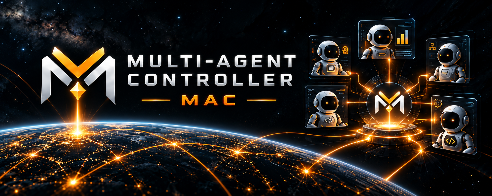
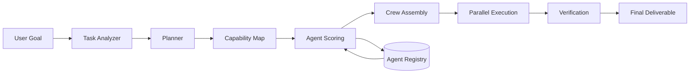
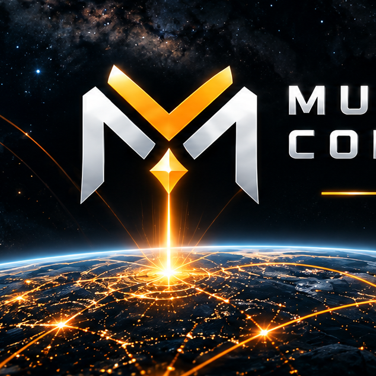

<div align="center">



# Multi-Agent Controller

### One controller. Many agents. Coordinated execution.

**Plan → Route → Assign → Execute → Verify → Deliver**

<br>


</div>

---

## What is Multi-Agent Controller?

**Multi-Agent Controller (MAC)** is an orchestration layer for coordinating multiple specialized AI agents around a single goal.

Instead of asking one general-purpose agent to do everything, MAC:

- understands the task,
- breaks it into subtasks,
- identifies the capabilities required,
- scores available agents,
- assembles a specialist crew,
- executes work in parallel,
- verifies outputs,
- and produces one final deliverable.

The controller is the coordination layer between **intent** and **execution**.

---

## Core idea

```text
ONE GOAL
   │
   ▼
┌───────────────────────────┐
│  MULTI-AGENT CONTROLLER   │
└───────────────────────────┘
   │
   ├── Plan
   ├── Match
   ├── Assign
   ├── Execute
   ├── Verify
   └── Deliver
   │
   ▼
SPECIALIST AGENT CREW
```

A complex task should not be treated as one giant prompt.

Different parts of the job can require different specialists:

```text
Research Agent    → source discovery + synthesis
Coding Agent      → implementation
Data Agent        → analysis
Strategy Agent    → planning
Writing Agent     → communication
Verification Agent→ final checks
```

MAC coordinates those capabilities into one execution graph.

---

## Execution pipeline



Every run creates a receipt containing:

```text
task
selected crew
match scores
subtasks
execution order
verification state
final output
```

---

## Agent matching

Each agent receives a match score based on:

```text
skill_match
reputation
availability
cost_efficiency
```

Default scoring:

```text
score =
    skill_match      × 0.55
  + reputation       × 0.20
  + availability     × 0.15
  + cost_efficiency  × 0.10
```

Weights are configurable in:

```text
config/controller.json
```

---

## Included specialist agents

| Agent | Primary capability |
|---|---|
| Research Agent | research, source synthesis |
| Coding Agent | implementation, debugging |
| Data Agent | analysis, metrics |
| Strategy Agent | planning, prioritization |
| Writing Agent | copy, documentation |
| Verification Agent | quality checks |

The registry is intentionally simple so new agents can be added without changing the controller core.

---

## Quick start

### Requirements

- Python 3.10+

### Run the demo

```bash
python -m src.multi_agent_controller.cli \
  --task "Research three AI infra trends and create a launch brief"
```

Example output:

```text
task: Research three AI infra trends and create a launch brief

selected crew:
  Strategy Agent      0.83
  Research Agent      0.81
  Writing Agent       0.76
  Verification Agent  0.71

execution:
  01 plan
  02 research
  03 synthesize
  04 verify

status: VERIFIED
```

---

## Python usage

```python
from src.multi_agent_controller import (
    MultiAgentController,
    TaskRequest,
)

controller = MultiAgentController()

result = controller.run(
    TaskRequest(
        goal="Build a launch strategy for a new AI developer tool"
    )
)

print(result.crew)
print(result.steps)
print(result.status)
```

---

## Architecture

```text
┌─────────────────────────────────────────────────┐
│                  TASK SOURCES                   │
│ users · agents · apps · webhooks · automations │
└──────────────────────┬──────────────────────────┘
                       │
                       ▼
              ┌──────────────────┐
              │  TASK ANALYZER   │
              └────────┬─────────┘
                       │
                       ▼
              ┌──────────────────┐
              │     PLANNER      │
              └────────┬─────────┘
                       │
                       ▼
          ┌──────────────────────────┐
          │ MULTI-AGENT CONTROLLER   │
          │                          │
          │ capability map           │
          │ agent scoring            │
          │ crew assembly            │
          │ execution graph          │
          └──────────┬───────────────┘
                     │
        ┌────────────┼────────────┐
        ▼            ▼            ▼
     RESEARCH      CODING      STRATEGY
        │            │            │
        └────────────┼────────────┘
                     ▼
               VERIFICATION
                     │
                     ▼
              FINAL DELIVERABLE
```

---

## Repository structure

```text
multi-agent-controller/
│
├── assets/
│   ├── banner.png
│   └── logo.png
│
├── config/
│   └── controller.json
│
├── examples/
│   └── demo.py
│
├── src/
│   └── multi_agent_controller/
│       ├── __init__.py
│       ├── models.py
│       ├── registry.py
│       ├── planner.py
│       ├── matcher.py
│       ├── verifier.py
│       ├── controller.py
│       └── cli.py
│
├── tests/
│   └── test_controller.py
│
├── ARCHITECTURE.md
├── ROUTING.md
├── ROADMAP.md
├── pyproject.toml
└── README.md
```

---

## Design principles

### 01 — Specialists over one giant prompt

Different tasks need different capabilities.

### 02 — Controller before execution

The system decides **who should work** before asking agents to work.

### 03 — Parallel when possible

Independent subtasks can execute simultaneously.

### 04 — Verification is part of the pipeline

Completion is not the same as correctness.

### 05 — Every run is inspectable

Agent selection, match scores, execution steps and final status are recorded.

### 06 — The registry stays open

New agents can be added without rewriting the orchestration layer.

---

## Roadmap

### Phase 01 — Core Controller ✅

- [x] task analyzer
- [x] rule-based planner
- [x] agent registry
- [x] weighted matching
- [x] crew assembly
- [x] execution receipts
- [x] verification stage

### Phase 02 — Live Agent Adapters

- [ ] LLM provider adapters
- [ ] tool-enabled agents
- [ ] web research adapter
- [ ] code execution adapter
- [ ] streaming execution

### Phase 03 — Dynamic Orchestration

- [ ] runtime re-planning
- [ ] failed-agent fallback
- [ ] dynamic crew resizing
- [ ] cost-aware routing
- [ ] latency-aware routing

### Phase 04 — Reputation Layer

- [ ] per-agent reputation
- [ ] task-specific success scores
- [ ] historical match performance
- [ ] quality feedback loops

### Phase 05 — Distributed Controller

- [ ] remote agent registry
- [ ] distributed execution
- [ ] agent-to-agent messaging
- [ ] permissioned task routing
- [ ] persistent execution graph

---

## Example use cases

**Product launch**

Research → strategy → copy → verification.

**Software development**

Planning → coding → testing → review.

**Market research**

Source discovery → analysis → synthesis → final report.

**Operations**

Task classification → specialist assignment → execution → audit.

**Agent swarms**

One controller coordinates a larger pool of independent agents.

---

## Philosophy

The bottleneck in multi-agent systems is not the number of agents.

It is **coordination**.

A useful controller should answer:

> Which agents should work on this task, in what order, and how do we know the result is good?

That is the problem MAC is built around.

---

## Community

**Project:** Multi-Agent Controller  
**Ticker:** `MAC`

The token is separate from the controller logic itself; the repository is focused on the technical architecture and implementation.

---

<div align="center">



### Multi-Agent Controller

**COORDINATE · ORCHESTRATE · EXECUTE**

`MAC`

</div>
