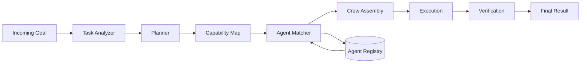

# Multi-Agent Controller

A lightweight orchestration layer for planning, routing, assigning, executing, and verifying work across multiple specialized AI agents.

---

## Overview

**Multi-Agent Controller** coordinates multiple specialist agents around a single goal.

Instead of relying on one general-purpose agent for every part of a task, the controller:

- analyzes the goal,
- decomposes it into subtasks,
- identifies required capabilities,
- scores available agents,
- assembles a specialist crew,
- executes work,
- verifies the outputs,
- and returns a single final result.

The controller separates **coordination logic** from **agent execution**.

---

## Core flow

```text
GOAL
  │
  ▼
TASK ANALYZER
  │
  ▼
PLANNER
  │
  ▼
CAPABILITY MAP
  │
  ▼
AGENT MATCHING
  │
  ▼
CREW ASSEMBLY
  │
  ▼
EXECUTION
  │
  ▼
VERIFICATION
  │
  ▼
FINAL RESULT
```

---

## Execution pipeline



Each run can record:

```text
goal
required capabilities
selected agents
match scores
subtasks
execution stages
verification status
final result
```

---

## Agent matching

Agents are ranked using configurable weighted signals:

```text
score =
    skill_match      × 0.55
  + reputation       × 0.20
  + availability     × 0.15
  + cost_efficiency  × 0.10
```

The weights can be changed in:

```text
config/controller.json
```

A candidate must also exceed the configured minimum match score before it can be selected.

---

## Included agent profiles

| Agent | Primary capabilities |
|---|---|
| Research Agent | research, sources, analysis |
| Coding Agent | implementation, debugging |
| Data Agent | data analysis, metrics |
| Strategy Agent | planning, prioritization |
| Writing Agent | synthesis, documentation |
| Verification Agent | review, quality control |

The registry is intentionally simple so additional specialist agents can be added without changing the controller core.

---

## Quick start

### Requirements

- Python 3.10+

### Run a task

```bash
python -m src.multi_agent_controller.cli \
  --task "Research three AI infrastructure trends and create a launch brief"
```

Example output:

```text
task: Research three AI infrastructure trends and create a launch brief

selected crew:
  Strategy Agent      0.83
  Research Agent      0.81
  Writing Agent       0.76
  Verification Agent  0.71

execution:
  01 plan
  02 match
  03 assign
  04 execute
  05 verify
  06 deliver

status: VERIFIED
```

---

## Python usage

```python
from src.multi_agent_controller import (
    MultiAgentController,
    TaskRequest,
)

controller = MultiAgentController()

result = controller.run(
    TaskRequest(
        goal="Build a launch strategy for a new AI developer tool"
    )
)

print(result.crew)
print(result.steps)
print(result.status)
```

---

## Architecture

```text
┌─────────────────────────────────────────────────┐
│                  TASK SOURCES                   │
│ users · agents · apps · webhooks · automations │
└──────────────────────┬──────────────────────────┘
                       │
                       ▼
              ┌──────────────────┐
              │  TASK ANALYZER   │
              └────────┬─────────┘
                       │
                       ▼
              ┌──────────────────┐
              │     PLANNER      │
              └────────┬─────────┘
                       │
                       ▼
          ┌──────────────────────────┐
          │  MULTI-AGENT CONTROLLER  │
          │                          │
          │  capability map          │
          │  agent scoring           │
          │  crew assembly           │
          │  execution graph         │
          └──────────┬───────────────┘
                     │
        ┌────────────┼────────────┐
        ▼            ▼            ▼
     RESEARCH      CODING      STRATEGY
        │            │            │
        └────────────┼────────────┘
                     ▼
               VERIFICATION
                     │
                     ▼
                 RESULT
```

---

## Repository structure

```text
multi-agent-controller/
│
├── config/
│   └── controller.json
│
├── examples/
│   └── demo.py
│
├── src/
│   └── multi_agent_controller/
│       ├── __init__.py
│       ├── models.py
│       ├── registry.py
│       ├── planner.py
│       ├── matcher.py
│       ├── verifier.py
│       ├── controller.py
│       └── cli.py
│
├── tests/
│   └── test_controller.py
│
├── ARCHITECTURE.md
├── ROUTING.md
├── ROADMAP.md
├── pyproject.toml
├── LICENSE
└── README.md
```

---

## Design principles

### 1. Separate orchestration from execution

The controller decides **who should work and how** before any agent performs the task.

### 2. Use specialists

Different subtasks may require different capabilities.

### 3. Keep selection inspectable

Agent choice should be based on explicit scoring rather than opaque selection.

### 4. Verify before completion

Execution is not considered complete until outputs pass the verification stage.

### 5. Keep the registry extensible

New agents can be added without rewriting the orchestration layer.

### 6. Keep provider logic outside the controller

The core architecture remains provider-agnostic so execution adapters can change independently.

---

## Roadmap

### Phase 01 — Controller Core

- [x] task analyzer
- [x] rule-based planner
- [x] agent registry
- [x] weighted agent matching
- [x] crew assembly
- [x] execution stages
- [x] verification
- [x] run result object

### Phase 02 — Agent Adapters

- [ ] LLM provider adapters
- [ ] tool-enabled agents
- [ ] web research adapter
- [ ] code execution adapter
- [ ] streaming execution

### Phase 03 — Dynamic Orchestration

- [ ] runtime re-planning
- [ ] failed-agent fallback
- [ ] dynamic crew resizing
- [ ] cost-aware routing
- [ ] latency-aware routing

### Phase 04 — Reputation

- [ ] per-agent execution history
- [ ] task-specific success scores
- [ ] historical match performance
- [ ] quality feedback loops

### Phase 05 — Distributed Controller

- [ ] remote agent registry
- [ ] distributed execution
- [ ] agent-to-agent messaging
- [ ] permissioned task routing
- [ ] persistent execution graph

---

## Example use cases

### Product work

Research → strategy → implementation → verification.

### Software development

Planning → coding → testing → review.

### Research

Source discovery → analysis → synthesis → verification.

### Operations

Task classification → specialist assignment → execution → audit.

### Large agent systems

Use one controller as the coordination layer across a wider pool of specialized workers.

---

## Philosophy

The difficult part of a multi-agent system is not creating more agents.

It is coordinating them well.

The controller focuses on three questions:

1. Which capabilities does this task require?
2. Which agents are best suited for those capabilities?
3. How should their work be combined and verified?

That coordination layer is the core of Multi-Agent Controller.
